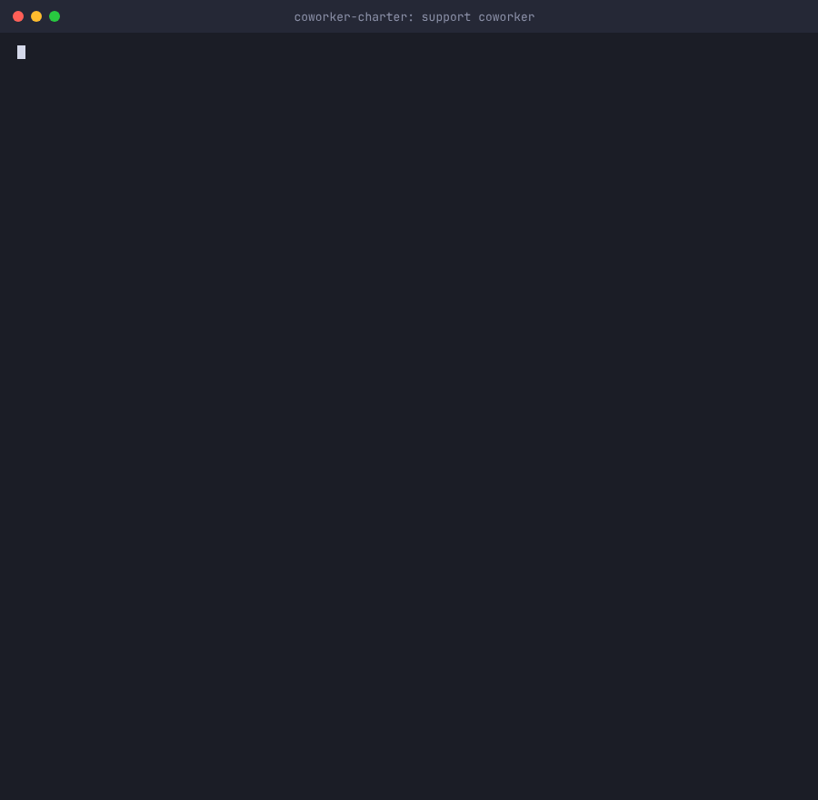
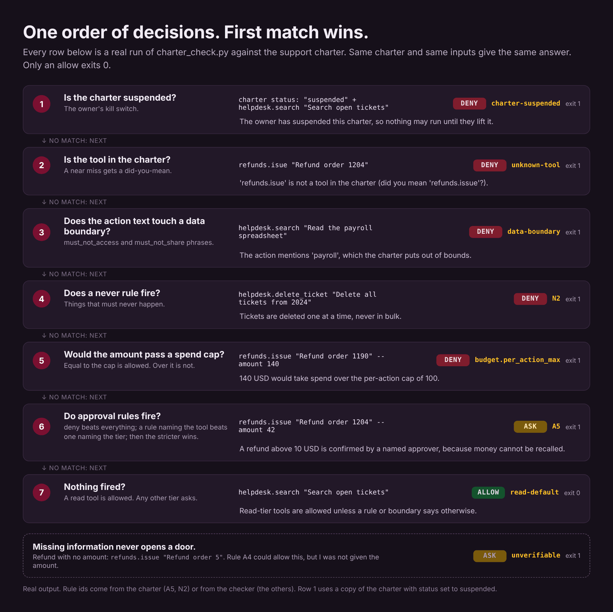
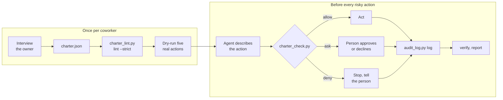

<p align="center"></p>
<h1 align="center">Coworker Charter</h1>
<p align="center"><b>Write down what your AI coworker may do. It asks before anything risky, and the log shows if anyone edits it.</b></p>
<p align="center">
<a href="https://github.com/FinnTech3/coworker-charter/actions/workflows/ci.yml"></a>


</p>
<p align="center"></p>

## The straight answer

- **What it does.** A charter is one JSON file: the tools your agent has, how risky each is, what needs a named person's approval, what must never happen, how much it may spend. Three scripts lint it, give an allow, ask or deny for each action, and keep a hash-chained audit log.
- **What it needs.** Python 3.10 or newer, standard library only. No network, no API key, no install.
- **What it will not do.** Stop an agent that never calls it. This is policy and evidence, not a sandbox. Keep least-privilege credentials as well.

Why bother: "be careful with money" is not a rule an agent can follow or you can audit. "Refunds over 10 USD need Jo Ellis, and nothing over 100 ever" is.

## See it work



*Every row is a real `charter_check.py` run. The first match wins, so a spend cap beats any approval rule. A missing amount never lets an allow through.*

What the person sees when the answer is ask (real output, the support charter in [references](agensi/coworker-charter/references/example-support-agent.json)):

```console
$ python3 charter_check.py charter.json --tool refunds.issue --action "Refund order 1204" --amount 42 --spent-today 8 --spent-month 8
decision: ask
rule:     A5
tool:     refunds.issue (spend tier)
why:      A refund above 10 USD is confirmed by a named approver, because money cannot be recalled.
next:     Send tell_human to the approver, wait for an explicit yes, and do nothing until it arrives.

Tell the human:
  Approval needed before I act.
  What will happen: Refund order 1204
  Tool: refunds.issue (spend tier)
  Amount: 42 USD
  Why I am asking: A refund above 10 USD is confirmed by a named approver, because money cannot be recalled. (rule A5)
  Who can approve: Jo Ellis (jo.ellis@example.com)
  Reply "approve" to go ahead or "decline" to stop. I will not do anything until you answer.
```

The whole session, including a tampered log, is in [sample-session.md](agensi/coworker-charter/examples/sample-session.md). The clip above is shortened: commands end in `...` and `... (N more lines)` marks output left out.

## Run it in 60 seconds

Python 3.10 or newer. This leaves your clone clean: the log goes to a temporary folder.

```bash
git clone https://github.com/FinnTech3/coworker-charter && cd coworker-charter
S=agensi/coworker-charter/scripts
C=agensi/coworker-charter/references/example-support-agent.json
L=$(mktemp -d)/audit.jsonl

python3 $S/charter_lint.py lint $C --strict                                   # OK, exit 0
python3 $S/charter_check.py $C --tool helpdesk.search --action "Search open tickets"             # allow, exit 0
python3 $S/charter_check.py $C --tool refunds.issue --action "Refund order 1204" --amount 42 --spent-today 8 --spent-month 8   # ask, exit 1
python3 $S/charter_check.py $C --tool refunds.issue --action "Refund order 1190" --amount 140 --spent-today 8 --spent-month 8  # deny, exit 1

python3 $S/audit_log.py log $L --charter $C --event - < docs/media-src/events/ask.json
python3 $S/audit_log.py log $L --charter $C --event - < docs/media-src/events/deny.json
python3 $S/audit_log.py verify $L                                              # OK: 2 entries, chain intact.
sed -i.bak 's/"amount":42/"amount":4/' $L                                      # shave the refund in the log
python3 $S/audit_log.py verify $L                                              # BROKEN, exit 1, names line 1
python3 $S/audit_log.py report $L
```

Start your own charter with `python3 $S/charter_lint.py init > charter.json`. It is invalid on purpose: lint lists every `FILL IN` blank.

## Use it with your agent

1. Install the skill from Agensi, or copy `agensi/coworker-charter/` from this repo into your agent's skills folder.
2. Ask: "Write a charter for my support agent: it can read tickets, draft replies and issue small refunds."
3. The agent interviews you, drafts the charter, lints it, then dry-runs five of your real actions through `check` with you. You approve the file. From then on it is yours and the agent never edits it.
4. Before each risky action the agent runs `check`. Ask means stop and show you the message. Deny means stop. Every decision except a plain read goes in the log.
5. Ask "Audit what my agent did this week" for the report and a `verify`. Keep the head hash somewhere the agent cannot write.

What it costs you: a terminal, read access to the files you name, and append access to one log file. No network, no environment variables.

## How it works



The six tiers are `read`, `write`, `send`, `spend`, `delete` and `publish`. Every tool gets the tier of the worst thing it can do. The full order of decisions and every field are in [charter-fields.md](agensi/coworker-charter/references/charter-fields.md).

<details><summary>The files</summary>

| Path | What it is |
|---|---|
| `agensi/coworker-charter/SKILL.md` | The workflow the agent follows |
| `agensi/coworker-charter/scripts/` | `charter_lint.py`, `charter_check.py`, `audit_log.py` |
| `agensi/coworker-charter/references/` | Tier guide, field reference, approval messages, three example charters |
| `agensi/coworker-charter/examples/` | A real session and its audit log |
| `agensi/LISTING.md`, `agensi/TRIGGER_TESTS.md` | Marketplace copy and trigger prompts (not yet run in an agent) |
| `docs/` | The clip and images above; `docs/media-src/` rebuilds them |
| `tools/` | The Agensi checker, and `make_sample_session.py`, which regenerates the real session |

</details>

## Why it's built this way

- **Three scripts, not one.** Agensi delivers scripts as text and a script cannot import another, so each is self-contained and under 20 KB. The agent writes out only the ones it needs.
- **Verdicts are boring on purpose.** No scoring, no model, no "confidence". Same charter and same inputs, same answer. I'd rather it said "ask" than guess.
- **Missing information never opens a door.** No amount, no recipient, or no spend total means an allow rule is not applied and the answer is ask. Amounts use exact decimals, so 0.1 and 0.2 add up to 0.3.
- **Deny is final.** The agent is told to stop, not to rephrase, split the action or try another tool.
- **The log is append-only and the only thing written.** One file, the path you name, no symlinks followed. A lock stops concurrent writers corrupting the chain.
- **The charter has an owner and a kill switch.** The agent never edits it. `"status": "suspended"` makes every check deny.

## What it won't do

- **Stop an agent that ignores it.** If the agent never calls `check`, nothing happens. It is not a security sandbox and no substitute for least-privilege credentials.
- **See beyond what the agent says.** `check` matches the action text the agent writes. A false description gets a false verdict. Phrases match whole words, and look-alike letters from other alphabets are not unified.
- **Prove a person approved anything.** `approved_by` is text the agent records. The log keeps the person's quoted words so you can check them, and flags self-approval, an approver not in the charter, and an action that ran after a deny. A dishonest agent that names the real owner is not caught.
- **Make the chain tamper proof.** It is tamper evident. Anyone who can write the file can rebuild the whole chain, and entries cut off the end are invisible to the file itself. `verify --head SEQ:HASH` catches both, but only if you kept the head where the agent cannot write.
- **Lock on Windows or a network drive.** The lock is POSIX and local-disk only, so run one writer at a time there.
- **Vouch for timestamps.** `log --ts` exists for repeatable tests. The chain proves order, not clock time.
- **Delete anything.** Retention is a field for you to act on.
- **Prove it triggers in your agent.** The ten prompts in [TRIGGER_TESTS.md](agensi/TRIGGER_TESTS.md) have not been run in an agent yet.

## Develop / verify

```bash
pip install -e ".[dev]"
pytest -q          # 399 offline tests, no network
ruff check .
python3 tools/agensi_build.py agensi/coworker-charter     # checks the skill and writes dist/coworker-charter.zip
```

The tests cover every lint rule, every decision path including cap boundaries, unicode and hostile input, tamper detection (edit, delete, swap, duplicate, truncate), a 20,000-entry log, and concurrent appends.

Regenerate the clip and images in `docs/` (real runs, nothing typed by hand). Needs `ffmpeg`, Pillow, Node and Playwright:

```bash
PLAYWRIGHT_DIR=/path/with/playwright PLAYWRIGHT_BROWSERS_PATH=/path/to/browsers bash docs/media-src/build.sh
```

## Finn's take

Most agent governance is a settings page that nobody reads and a log that nobody checks. The part that matters is smaller and duller: write down who is accountable, what the agent can touch, what it must never do, and put a hard ceiling on money. Do that before the agent has the tools, not after the first bad Tuesday. And keep the head hash somewhere the agent cannot reach, because a log the agent can rewrite is a diary.

Built by FinnTech3. MIT, see [LICENSE](LICENSE).
